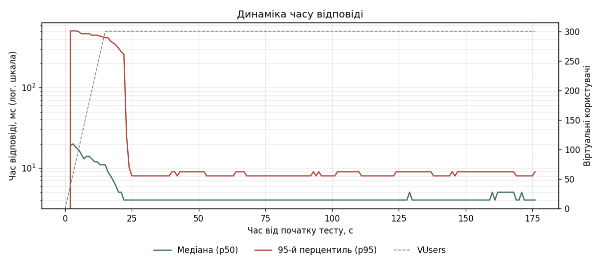
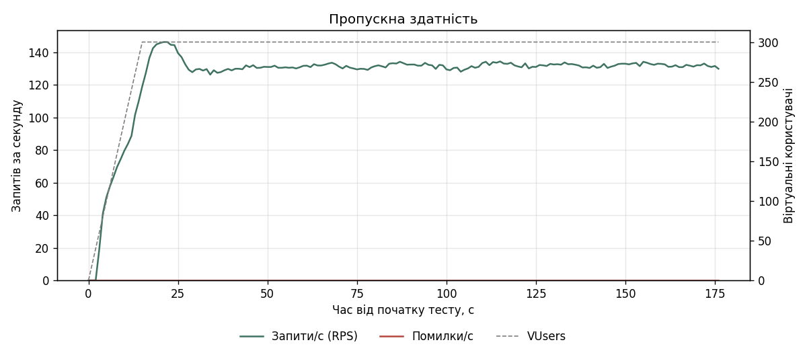
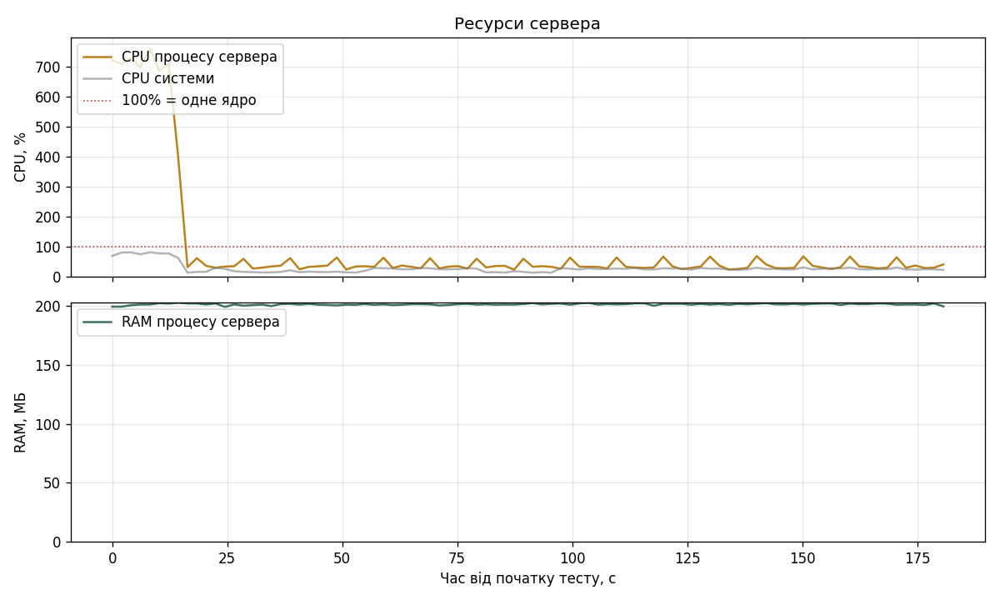
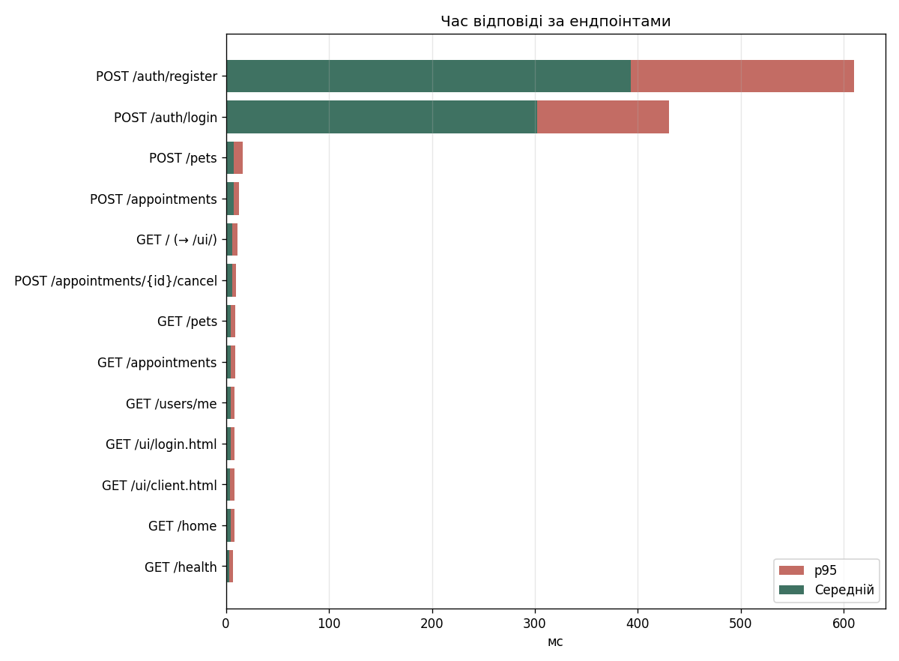

# Звіт навантажувального тестування — `after-300-nocache` (профіль `baseline`)

| Параметр | Значення |
|---|---|
| Інструмент | Locust |
| Профіль навантаження | 300 VUsers, розгін 20 корист./с (Ramp-Up ≈ 15 с), тривалість 180 с |
| Середовище | `sandbox`, http://localhost:80 |
| Суміш користувачів | клієнти 6 : анонімні 2 |
| Машина | Darwin arm64, 10 логічних ядер, Python 3.9.6 |
| Початок | 2026-11-22T13:02:56, фактична тривалість 182.2 с |

## Підсумкові метрики

| Ендпоінт | Запитів | Помилок | Error Rate | RPS | Avg, мс | Min, мс | Max, мс | p50, мс | p95, мс | p99, мс |
|---|---:|---:|---:|---:|---:|---:|---:|---:|---:|---:|
| POST /auth/register | 225 | 0 | 0.00% | 1.3 | 393 | 236 | 751 | 380 | 610 | 710 |
| POST /auth/login | 225 | 0 | 0.00% | 1.3 | 302 | 182 | 490 | 290 | 430 | 460 |
| POST /pets | 1390 | 0 | 0.00% | 7.8 | 7 | 3 | 39 | 6 | 16 | 28 |
| POST /appointments | 1177 | 0 | 0.00% | 6.6 | 8 | 3 | 59 | 7 | 13 | 26 |
| GET / (→ /ui/) | 1854 | 0 | 0.00% | 10.4 | 6 | 2 | 63 | 5 | 11 | 32 |
| POST /appointments/{id}/cancel | 680 | 0 | 0.00% | 3.8 | 6 | 3 | 19 | 6 | 10 | 14 |
| GET /appointments | 3409 | 0 | 0.00% | 19.0 | 5 | 2 | 43 | 4 | 9 | 17 |
| GET /pets | 4593 | 0 | 0.00% | 25.7 | 5 | 2 | 61 | 4 | 9 | 17 |
| GET /home | 4448 | 0 | 0.00% | 24.8 | 4 | 1 | 49 | 4 | 8 | 14 |
| GET /ui/client.html | 1167 | 0 | 0.00% | 6.5 | 4 | 1 | 37 | 3 | 8 | 14 |
| GET /ui/login.html | 1289 | 0 | 0.00% | 7.2 | 4 | 1 | 59 | 3 | 8 | 33 |
| GET /users/me | 2237 | 0 | 0.00% | 12.5 | 4 | 2 | 35 | 4 | 8 | 12 |
| GET /health | 604 | 0 | 0.00% | 3.4 | 3 | 1 | 37 | 2 | 7 | 18 |
| **Усього (Aggregated)** | 23298 | 0 | 0.00% | 130.1 | 12 | 1 | 751 | 4 | 11 | 310 |

## Ресурси сервера

| Показник | Середнє | Максимум |
|---|---:|---:|
| CPU процесу сервера, % одного ядра | 94 | 761 |
| RAM процесу сервера, МБ | 201 | 203 |
| CPU PostgreSQL, % одного ядра | 5 | 9 |
| RAM PostgreSQL, МБ | 55 | 58 |
| CPU Redis, % одного ядра | 1 | 1 |
| RAM Redis, МБ | 10 | 11 |
| CPU системи, % | 27 | 81 |
| RAM системи, % | — | 70 |

> Locust працює на тій самій машині, що й сервер, тож частину CPU системи займає сам генератор навантаження. Для Docker «процес сервера» — це сума всіх реплік застосунку.

## Графіки

### Динаміка часу відповіді

### Пропускна здатність

### Ресурси сервера (CPU, RAM)

### Час відповіді за ендпоінтами

## Виявлені вузькі місця

1. **Автентифікація — найдорожча операція.** p95 входу/реєстрації 610 мс проти 9 мс (медіана p95 інших ендпоінтів). Ймовірна причина: хешування паролів bcrypt навмисно повільне і виконується синхронно всередині async-обробника, тож блокує цикл подій — поки рахується хеш, сервер не обробляє жодного іншого запиту. Можливе рішення: виконувати bcrypt у пулі потоків (`run_in_threadpool`) і/або запускати кілька воркерів uvicorn.
2. **Сплеск затримки.** p95 зріс до 510 мс (типове значення 9 мс) при 40 VUsers, під час розгону або одразу після нього, коли нові користувачі масово реєструються та входять.
3. **CPU.** Процес сервера досягав 761% одного ядра. Uvicorn з одним воркером використовує лише одне ядро, тож це стеля продуктивності незалежно від кількості ядер машини.
4. **RAM.** Пам'ять процесу 201–203 МБ — витоків пам'яті не помітно, якщо графік RAM не зростає безперервно.

> Розділ сформовано автоматично за порогами: Error Rate > 1%, p95 > 2× від базового ступеня, сплеск p95 > 3× від типового, CPU ≥ 90% одного ядра. Перевірте висновки за графіками.
