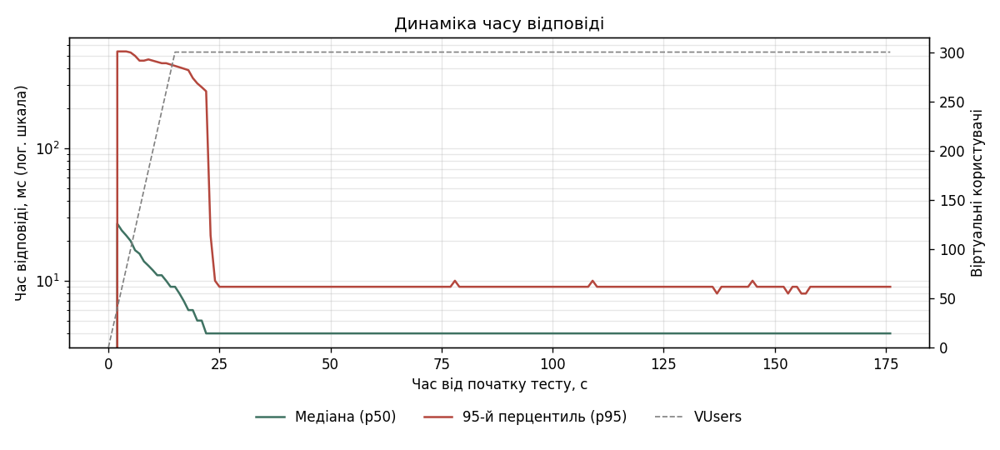
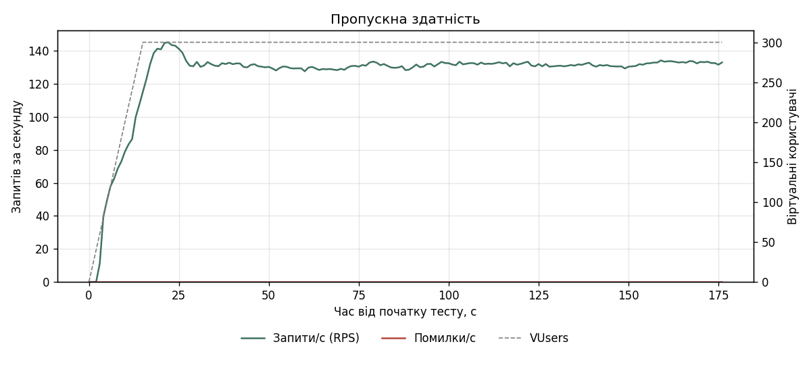
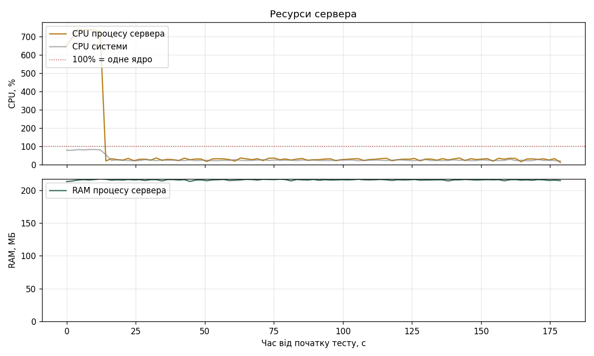
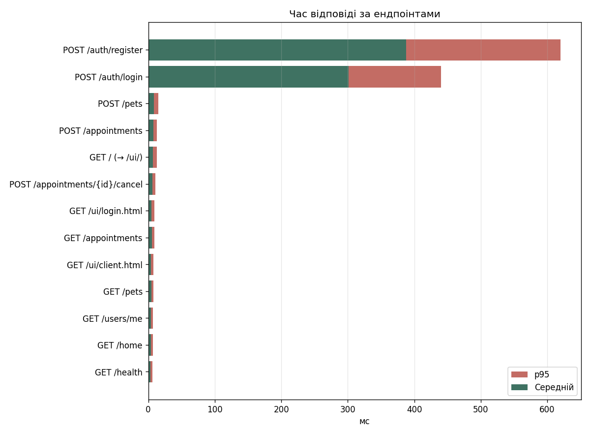

# Звіт навантажувального тестування — `after-300` (профіль `baseline`)

| Параметр | Значення |
|---|---|
| Інструмент | Locust |
| Профіль навантаження | 300 VUsers, розгін 20 корист./с (Ramp-Up ≈ 15 с), тривалість 180 с |
| Середовище | `sandbox`, http://localhost:80 |
| Суміш користувачів | клієнти 6 : анонімні 2 |
| Машина | Darwin arm64, 10 логічних ядер, Python 3.9.6 |
| Початок | 2026-11-22T13:06:24, фактична тривалість 180.8 с |

## Підсумкові метрики

| Ендпоінт | Запитів | Помилок | Error Rate | RPS | Avg, мс | Min, мс | Max, мс | p50, мс | p95, мс | p99, мс |
|---|---:|---:|---:|---:|---:|---:|---:|---:|---:|---:|
| POST /auth/register | 225 | 0 | 0.00% | 1.3 | 388 | 234 | 716 | 380 | 620 | 660 |
| POST /auth/login | 225 | 0 | 0.00% | 1.3 | 302 | 194 | 504 | 290 | 440 | 470 |
| POST /pets | 1409 | 0 | 0.00% | 7.9 | 8 | 3 | 119 | 7 | 15 | 28 |
| GET / (→ /ui/) | 1862 | 0 | 0.00% | 10.4 | 7 | 3 | 94 | 5 | 13 | 35 |
| POST /appointments | 1153 | 0 | 0.00% | 6.4 | 8 | 3 | 48 | 7 | 13 | 24 |
| POST /appointments/{id}/cancel | 648 | 0 | 0.00% | 3.6 | 7 | 3 | 38 | 6 | 11 | 15 |
| GET /appointments | 3533 | 0 | 0.00% | 19.7 | 5 | 2 | 39 | 5 | 9 | 14 |
| GET /ui/login.html | 1264 | 0 | 0.00% | 7.1 | 5 | 1 | 62 | 3 | 9 | 32 |
| GET /pets | 4513 | 0 | 0.00% | 25.2 | 4 | 1 | 88 | 4 | 8 | 13 |
| GET /ui/client.html | 1147 | 0 | 0.00% | 6.4 | 4 | 1 | 45 | 3 | 8 | 13 |
| GET /home | 4454 | 0 | 0.00% | 24.9 | 4 | 1 | 36 | 3 | 7 | 10 |
| GET /users/me | 2278 | 0 | 0.00% | 12.7 | 4 | 1 | 79 | 3 | 7 | 10 |
| GET /health | 601 | 0 | 0.00% | 3.4 | 3 | 1 | 37 | 3 | 6 | 14 |
| **Усього (Aggregated)** | 23312 | 0 | 0.00% | 130.2 | 12 | 1 | 716 | 4 | 11 | 290 |

## Ресурси сервера

| Показник | Середнє | Максимум |
|---|---:|---:|
| CPU процесу сервера, % одного ядра | 84 | 742 |
| RAM процесу сервера, МБ | 215 | 217 |
| CPU PostgreSQL, % одного ядра | 3 | 7 |
| RAM PostgreSQL, МБ | 56 | 58 |
| CPU Redis, % одного ядра | 1 | 2 |
| RAM Redis, МБ | 11 | 11 |
| CPU системи, % | 29 | 84 |
| RAM системи, % | — | 70 |

> Locust працює на тій самій машині, що й сервер, тож частину CPU системи займає сам генератор навантаження. Для Docker «процес сервера» — це сума всіх реплік застосунку.

## Графіки

### Динаміка часу відповіді

### Пропускна здатність

### Ресурси сервера (CPU, RAM)

### Час відповіді за ендпоінтами

## Виявлені вузькі місця

1. **Автентифікація — найдорожча операція.** p95 входу/реєстрації 620 мс проти 9 мс (медіана p95 інших ендпоінтів). Ймовірна причина: хешування паролів bcrypt навмисно повільне і виконується синхронно всередині async-обробника, тож блокує цикл подій — поки рахується хеш, сервер не обробляє жодного іншого запиту. Можливе рішення: виконувати bcrypt у пулі потоків (`run_in_threadpool`) і/або запускати кілька воркерів uvicorn.
2. **Сплеск затримки.** p95 зріс до 540 мс (типове значення 9 мс) при 40 VUsers, під час розгону або одразу після нього, коли нові користувачі масово реєструються та входять.
3. **CPU.** Процес сервера досягав 742% одного ядра. Uvicorn з одним воркером використовує лише одне ядро, тож це стеля продуктивності незалежно від кількості ядер машини.
4. **RAM.** Пам'ять процесу 215–217 МБ — витоків пам'яті не помітно, якщо графік RAM не зростає безперервно.

> Розділ сформовано автоматично за порогами: Error Rate > 1%, p95 > 2× від базового ступеня, сплеск p95 > 3× від типового, CPU ≥ 90% одного ядра. Перевірте висновки за графіками.
