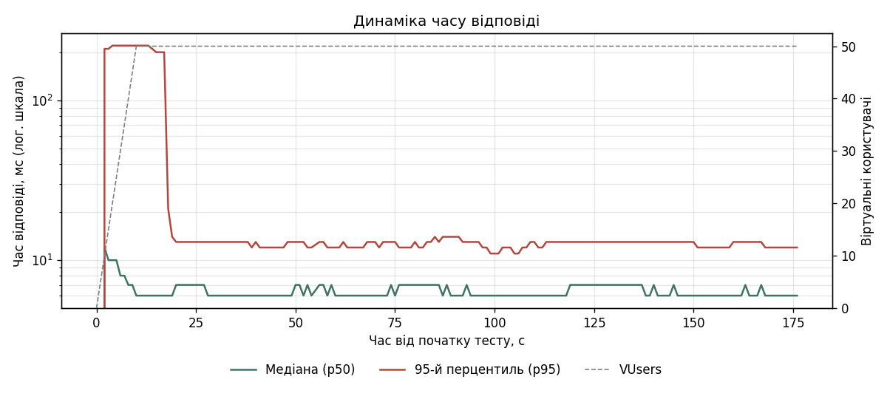
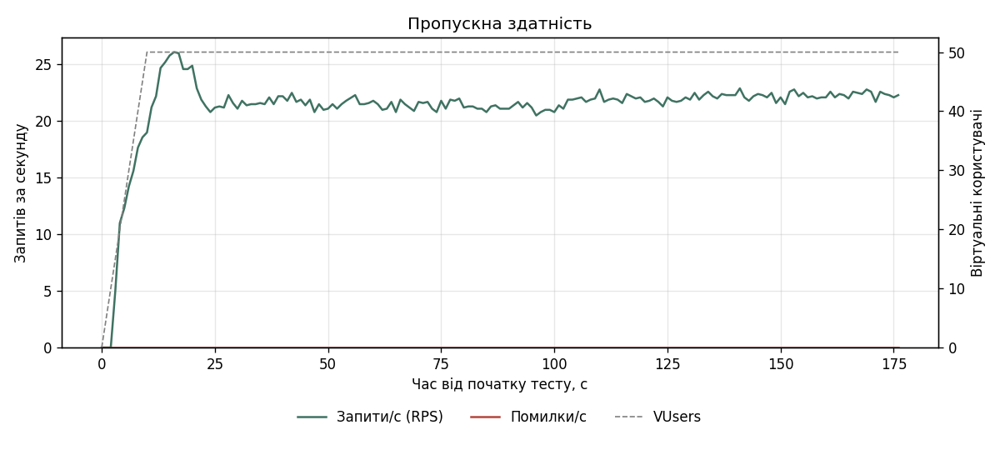
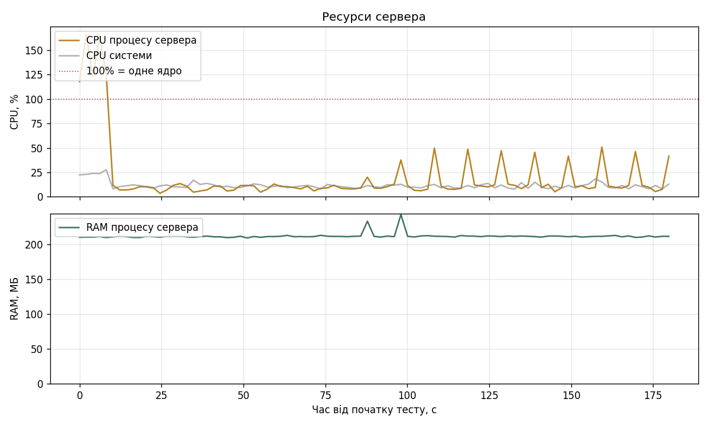
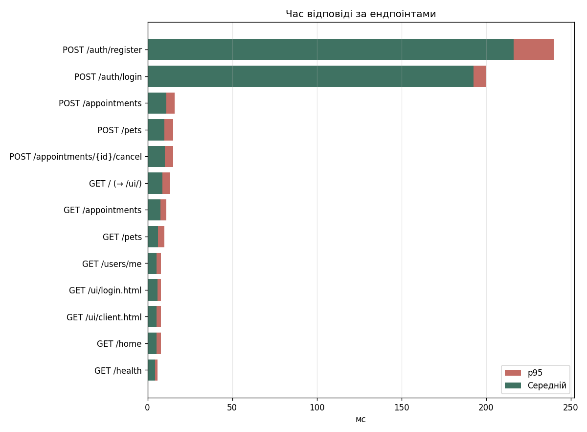

# Звіт навантажувального тестування — `after-50` (профіль `baseline`)

| Параметр | Значення |
|---|---|
| Інструмент | Locust |
| Профіль навантаження | 50 VUsers, розгін 5 корист./с (Ramp-Up ≈ 10 с), тривалість 180 с |
| Середовище | `sandbox`, http://localhost:80 |
| Суміш користувачів | клієнти 6 : анонімні 2 |
| Машина | Darwin arm64, 10 логічних ядер, Python 3.9.6 |
| Початок | 2026-11-22T12:55:59, фактична тривалість 181.9 с |

## Підсумкові метрики

| Ендпоінт | Запитів | Помилок | Error Rate | RPS | Avg, мс | Min, мс | Max, мс | p50, мс | p95, мс | p99, мс |
|---|---:|---:|---:|---:|---:|---:|---:|---:|---:|---:|
| POST /auth/register | 37 | 0 | 0.00% | 0.2 | 216 | 195 | 238 | 220 | 240 | 240 |
| POST /auth/login | 37 | 0 | 0.00% | 0.2 | 192 | 189 | 199 | 190 | 200 | 200 |
| POST /appointments | 171 | 0 | 0.00% | 1.0 | 11 | 4 | 19 | 12 | 16 | 19 |
| POST /appointments/{id}/cancel | 107 | 0 | 0.00% | 0.6 | 10 | 4 | 22 | 11 | 15 | 16 |
| POST /pets | 232 | 0 | 0.00% | 1.3 | 10 | 3 | 18 | 10 | 15 | 17 |
| GET / (→ /ui/) | 333 | 0 | 0.00% | 1.9 | 9 | 3 | 38 | 9 | 13 | 24 |
| GET /appointments | 597 | 0 | 0.00% | 3.3 | 8 | 3 | 14 | 8 | 11 | 13 |
| GET /pets | 753 | 0 | 0.00% | 4.2 | 6 | 1 | 28 | 6 | 10 | 12 |
| GET /home | 773 | 0 | 0.00% | 4.3 | 5 | 2 | 12 | 5 | 8 | 10 |
| GET /ui/client.html | 189 | 0 | 0.00% | 1.1 | 5 | 2 | 27 | 5 | 8 | 10 |
| GET /ui/login.html | 214 | 0 | 0.00% | 1.2 | 6 | 2 | 49 | 6 | 8 | 11 |
| GET /users/me | 365 | 0 | 0.00% | 2.0 | 5 | 2 | 14 | 5 | 8 | 9 |
| GET /health | 109 | 0 | 0.00% | 0.6 | 4 | 1 | 15 | 5 | 6 | 7 |
| **Усього (Aggregated)** | 3917 | 0 | 0.00% | 21.9 | 11 | 1 | 238 | 6 | 13 | 200 |

## Ресурси сервера

| Показник | Середнє | Максимум |
|---|---:|---:|
| CPU процесу сервера, % одного ядра | 20 | 166 |
| RAM процесу сервера, МБ | 211 | 242 |
| CPU PostgreSQL, % одного ядра | 1 | 7 |
| RAM PostgreSQL, МБ | 41 | 42 |
| CPU Redis, % одного ядра | 1 | 2 |
| RAM Redis, МБ | 10 | 11 |
| CPU системи, % | 12 | 28 |
| RAM системи, % | — | 67 |

> Locust працює на тій самій машині, що й сервер, тож частину CPU системи займає сам генератор навантаження. Для Docker «процес сервера» — це сума всіх реплік застосунку.

## Графіки

### Динаміка часу відповіді

### Пропускна здатність

### Ресурси сервера (CPU, RAM)

### Час відповіді за ендпоінтами

## Виявлені вузькі місця

1. **Автентифікація — найдорожча операція.** p95 входу/реєстрації 240 мс проти 10 мс (медіана p95 інших ендпоінтів). Ймовірна причина: хешування паролів bcrypt навмисно повільне і виконується синхронно всередині async-обробника, тож блокує цикл подій — поки рахується хеш, сервер не обробляє жодного іншого запиту. Можливе рішення: виконувати bcrypt у пулі потоків (`run_in_threadpool`) і/або запускати кілька воркерів uvicorn.
2. **Сплеск затримки.** p95 зріс до 220 мс (типове значення 13 мс) при 20 VUsers, під час розгону або одразу після нього, коли нові користувачі масово реєструються та входять.
3. **CPU.** Процес сервера досягав 166% одного ядра. Uvicorn з одним воркером використовує лише одне ядро, тож це стеля продуктивності незалежно від кількості ядер машини.
4. **RAM.** Пам'ять процесу 211–242 МБ — витоків пам'яті не помітно, якщо графік RAM не зростає безперервно.

> Розділ сформовано автоматично за порогами: Error Rate > 1%, p95 > 2× від базового ступеня, сплеск p95 > 3× від типового, CPU ≥ 90% одного ядра. Перевірте висновки за графіками.
