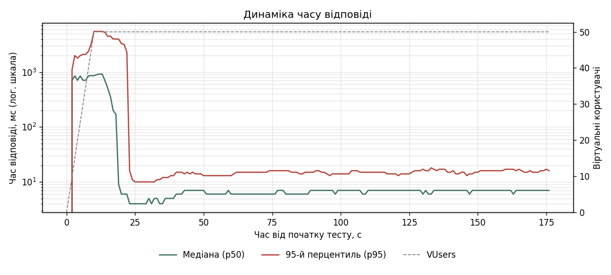
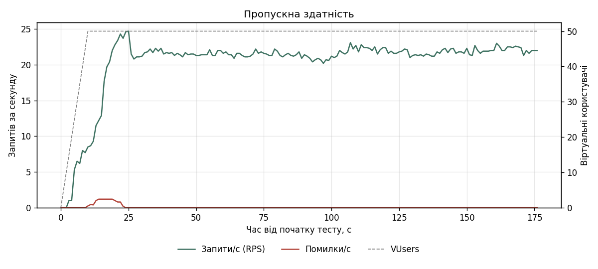
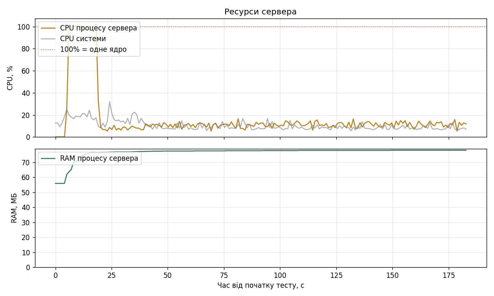
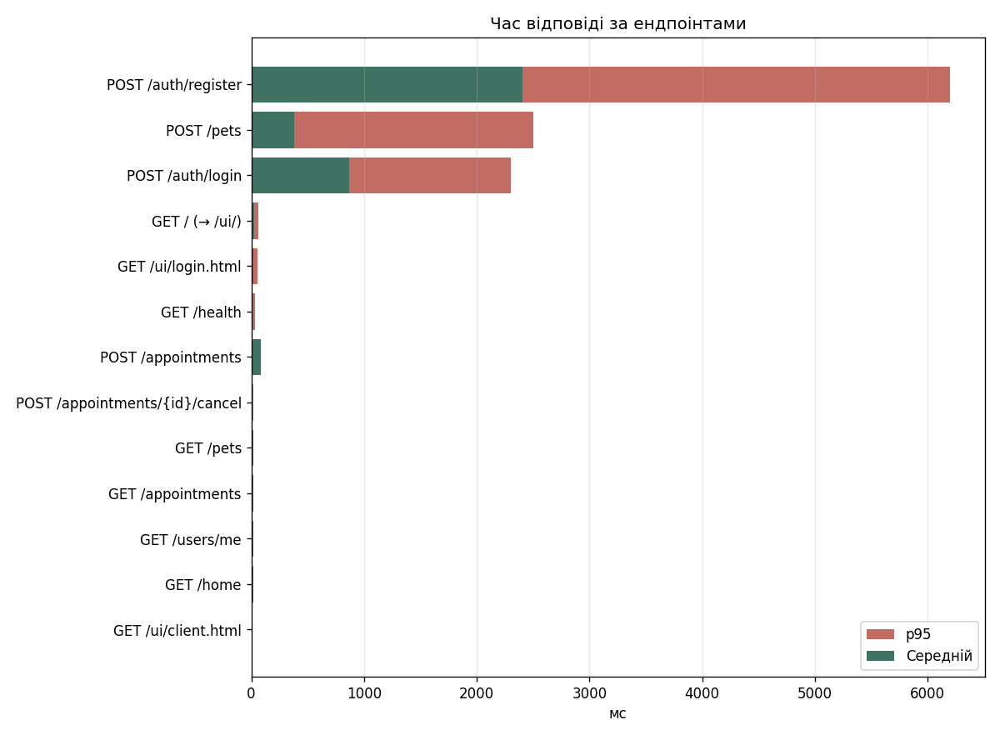

# Звіт навантажувального тестування — профіль `baseline`

| Параметр | Значення |
|---|---|
| Інструмент | Locust |
| Профіль навантаження | 50 VUsers, розгін 5 корист./с (Ramp-Up ≈ 10 с), тривалість 180 с |
| Середовище | `sandbox`, http://127.0.0.1:8000 |
| Суміш користувачів | клієнти 6 : анонімні 2 |
| Машина | Darwin arm64, 10 логічних ядер, Python 3.9.6 |
| Початок | 2026-10-25T16:32:50, фактична тривалість 184.3 с |

## Підсумкові метрики

| Ендпоінт | Запитів | Помилок | Error Rate | RPS | Avg, мс | Min, мс | Max, мс | p50, мс | p95, мс | p99, мс |
|---|---:|---:|---:|---:|---:|---:|---:|---:|---:|---:|
| POST /auth/register | 43 | 6 | 13.95% | 0.2 | 2406 | 2 | 6346 | 2000 | 6200 | 6300 |
| POST /pets | 215 | 3 | 1.40% | 1.2 | 376 | 3 | 6121 | 13 | 2500 | 5700 |
| POST /auth/login | 37 | 0 | 0.00% | 0.2 | 864 | 170 | 2419 | 850 | 2300 | 2400 |
| GET / (→ /ui/) | 329 | 0 | 0.00% | 1.8 | 22 | 1 | 735 | 5 | 62 | 510 |
| GET /ui/login.html | 213 | 0 | 0.00% | 1.2 | 16 | 1 | 511 | 3 | 55 | 420 |
| GET /health | 109 | 0 | 0.00% | 0.6 | 10 | 1 | 294 | 2 | 29 | 170 |
| POST /appointments | 170 | 0 | 0.00% | 1.0 | 85 | 5 | 4033 | 13 | 23 | 4000 |
| POST /appointments/{id}/cancel | 100 | 0 | 0.00% | 0.6 | 12 | 5 | 21 | 13 | 19 | 21 |
| GET /appointments | 549 | 0 | 0.00% | 3.1 | 18 | 2 | 1681 | 8 | 15 | 360 |
| GET /pets | 735 | 0 | 0.00% | 4.1 | 20 | 2 | 1908 | 8 | 15 | 480 |
| GET /users/me | 372 | 3 | 0.81% | 2.1 | 21 | 1 | 1824 | 6 | 11 | 550 |
| GET /home | 696 | 0 | 0.00% | 3.9 | 18 | 1 | 1791 | 6 | 10 | 580 |
| GET /ui/client.html | 212 | 0 | 0.00% | 1.2 | 5 | 1 | 358 | 3 | 8 | 13 |
| **Усього (Aggregated)** | 3780 | 12 | 0.32% | 21.2 | 77 | 1 | 6346 | 7 | 98 | 2300 |

## Ресурси сервера

| Показник | Середнє | Максимум |
|---|---:|---:|
| CPU процесу сервера, % одного ядра | 17 | 102 |
| RAM процесу сервера, МБ | 77 | 78 |
| CPU системи, % | 11 | 32 |
| RAM системи, % | — | 76 |

> Locust працює на тій самій машині, що й сервер, тож частину CPU системи займає сам генератор навантаження.

## Графіки

### Динаміка часу відповіді

### Пропускна здатність

### Ресурси сервера (CPU, RAM)

### Час відповіді за ендпоінтами

## Помилки

| Метод | Ендпоінт | Помилка | Кількість |
|---|---|---|---:|
| POST | POST /auth/register | 500 Server Error: Internal Server Error | 3 |
| POST | POST /pets | 500 Server Error: Internal Server Error | 3 |
| POST | POST /auth/register | ConnectionResetError | 3 |
| GET | GET /users/me | ConnectionResetError | 3 |

## Виявлені вузькі місця

1. **Поодинокі помилки.** Невдалих запитів: 12 (0.32%) — див. таблицю помилок.
2. **Автентифікація — найдорожча операція.** p95 входу/реєстрації 6200 мс проти 19 мс (медіана p95 інших ендпоінтів). Ймовірна причина: хешування паролів bcrypt навмисно повільне і виконується синхронно всередині async-обробника, тож блокує цикл подій — поки рахується хеш, сервер не обробляє жодного іншого запиту. Можливе рішення: виконувати bcrypt у пулі потоків (`run_in_threadpool`) і/або запускати кілька воркерів uvicorn.
3. **Сплеск затримки.** p95 зріс до 5500 мс (типове значення 15 мс) при 50 VUsers, під час розгону або одразу після нього, коли нові користувачі масово реєструються та входять.
4. **CPU.** Процес сервера досягав 102% одного ядра. Uvicorn з одним воркером використовує лише одне ядро, тож це стеля продуктивності незалежно від кількості ядер машини.
5. **RAM.** Пам'ять процесу 77–78 МБ — витоків пам'яті не помітно, якщо графік RAM не зростає безперервно.
6. **Типи помилок.** `POST /auth/register`: 500 Server Error: Internal Server Error ×3; `POST /pets`: 500 Server Error: Internal Server Error ×3; `POST /auth/register`: ConnectionResetError ×3.
7. **Помилки 500.** Подробиці видно лише в лозі сервера (рядки «Необроблена помилка …»). Для SQLite під конкурентним записом типова причина — `database is locked`: SQLite дозволяє лише одного записувача, а поки цикл подій заблоковано (наприклад, хешуванням bcrypt), транзакція не завершується і інші запити перевищують тайм-аут очікування. Рішення — PostgreSQL для production.
8. **Обірвані з'єднання.** Частина запитів завершилась `Connection reset` — сервер не встигав приймати нові з'єднання, поки цикл подій був зайнятий.

> Розділ сформовано автоматично за порогами: Error Rate > 1%, p95 > 2× від базового ступеня, сплеск p95 > 3× від типового, CPU ≥ 90% одного ядра. Перевірте висновки за графіками.
