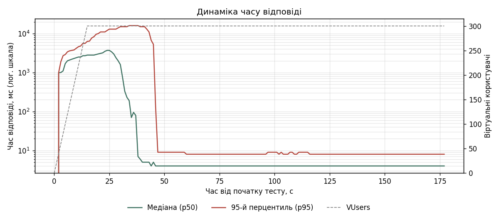
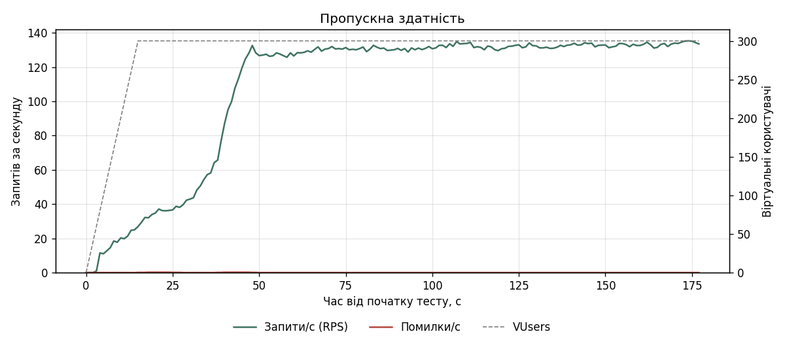
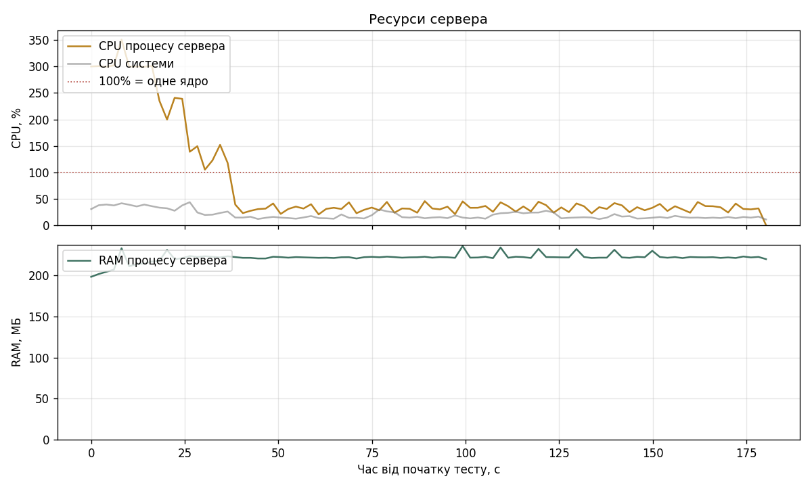
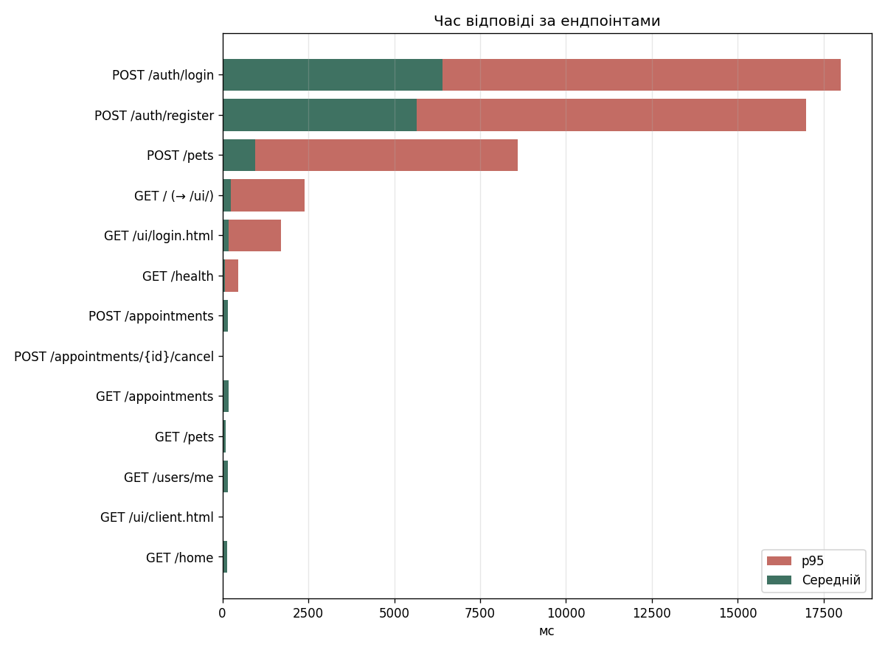

# Звіт навантажувального тестування — `before-300` (профіль `baseline`)

| Параметр | Значення |
|---|---|
| Інструмент | Locust |
| Профіль навантаження | 300 VUsers, розгін 20 корист./с (Ramp-Up ≈ 15 с), тривалість 180 с |
| Середовище | `sandbox`, http://localhost:80 |
| Суміш користувачів | клієнти 6 : анонімні 2 |
| Машина | Darwin arm64, 10 логічних ядер, Python 3.9.6 |
| Початок | 2026-11-22T12:59:28, фактична тривалість 181.7 с |

## Підсумкові метрики

| Ендпоінт | Запитів | Помилок | Error Rate | RPS | Avg, мс | Min, мс | Max, мс | p50, мс | p95, мс | p99, мс |
|---|---:|---:|---:|---:|---:|---:|---:|---:|---:|---:|
| POST /auth/login | 228 | 3 | 1.32% | 1.3 | 6403 | 69 | 30002 | 4600 | 18000 | 26000 |
| POST /auth/register | 229 | 1 | 0.44% | 1.3 | 5660 | 14 | 25268 | 3400 | 17000 | 22000 |
| POST /pets | 1172 | 0 | 0.00% | 6.5 | 945 | 3 | 20940 | 7 | 8600 | 16000 |
| GET / (→ /ui/) | 1746 | 0 | 0.00% | 9.7 | 251 | 2 | 6221 | 5 | 2400 | 4100 |
| GET /ui/login.html | 1180 | 0 | 0.00% | 6.6 | 190 | 1 | 5179 | 3 | 1700 | 3100 |
| GET /health | 612 | 0 | 0.00% | 3.4 | 77 | 1 | 4308 | 2 | 450 | 1500 |
| POST /appointments | 965 | 0 | 0.00% | 5.4 | 151 | 3 | 16942 | 7 | 13 | 6500 |
| GET /appointments | 2957 | 0 | 0.00% | 16.5 | 182 | 2 | 21416 | 5 | 10 | 8000 |
| POST /appointments/{id}/cancel | 558 | 0 | 0.00% | 3.1 | 27 | 3 | 11740 | 6 | 10 | 12 |
| GET /pets | 3944 | 0 | 0.00% | 22.0 | 101 | 2 | 28929 | 5 | 9 | 3200 |
| GET /users/me | 1981 | 0 | 0.00% | 11.0 | 153 | 2 | 18967 | 4 | 8 | 7400 |
| GET /home | 3914 | 0 | 0.00% | 21.8 | 127 | 2 | 18647 | 3 | 7 | 5500 |
| GET /ui/client.html | 994 | 0 | 0.00% | 5.5 | 31 | 1 | 4118 | 3 | 7 | 1500 |
| **Усього (Aggregated)** | 20480 | 4 | 0.02% | 114.1 | 318 | 1 | 30002 | 4 | 1400 | 9600 |

## Ресурси сервера

| Показник | Середнє | Максимум |
|---|---:|---:|
| CPU процесу сервера, % одного ядра | 75 | 351 |
| RAM процесу сервера, МБ | 222 | 236 |
| CPU PostgreSQL, % одного ядра | 4 | 8 |
| RAM PostgreSQL, МБ | 72 | 119 |
| CPU Redis, % одного ядра | 0 | 0 |
| RAM Redis, МБ | 0 | 0 |
| CPU системи, % | 20 | 44 |
| RAM системи, % | — | 68 |

> Locust працює на тій самій машині, що й сервер, тож частину CPU системи займає сам генератор навантаження. Для Docker «процес сервера» — це сума всіх реплік застосунку.

## Графіки

### Динаміка часу відповіді

### Пропускна здатність

### Ресурси сервера (CPU, RAM)

### Час відповіді за ендпоінтами

## Помилки

| Метод | Ендпоінт | Помилка | Кількість |
|---|---|---|---:|
| POST | POST /auth/register | 502 Server Error: Bad Gateway | 1 |
| POST | POST /auth/login | 502 Server Error: Bad Gateway | 1 |
| POST | POST /auth/login | 504 Server Error: Gateway Time-out | 2 |

## Виявлені вузькі місця

1. **Поодинокі помилки.** Невдалих запитів: 4 (0.02%) — див. таблицю помилок.
2. **Автентифікація — найдорожча операція.** p95 входу/реєстрації 18000 мс проти 10 мс (медіана p95 інших ендпоінтів). Ймовірна причина: хешування паролів bcrypt навмисно повільне і виконується синхронно всередині async-обробника, тож блокує цикл подій — поки рахується хеш, сервер не обробляє жодного іншого запиту. Можливе рішення: виконувати bcrypt у пулі потоків (`run_in_threadpool`) і/або запускати кілька воркерів uvicorn.
3. **Сплеск затримки.** p95 зріс до 16000 мс (типове значення 8 мс) при 300 VUsers, під час розгону або одразу після нього, коли нові користувачі масово реєструються та входять.
4. **CPU.** Процес сервера досягав 351% одного ядра. Uvicorn з одним воркером використовує лише одне ядро, тож це стеля продуктивності незалежно від кількості ядер машини.
5. **RAM.** Пам'ять процесу 222–236 МБ — витоків пам'яті не помітно, якщо графік RAM не зростає безперервно.
6. **Типи помилок.** `POST /auth/login`: 504 Server Error: Gateway Time-out ×2; `POST /auth/register`: 502 Server Error: Bad Gateway ×1; `POST /auth/login`: 502 Server Error: Bad Gateway ×1.

> Розділ сформовано автоматично за порогами: Error Rate > 1%, p95 > 2× від базового ступеня, сплеск p95 > 3× від типового, CPU ≥ 90% одного ядра. Перевірте висновки за графіками.
