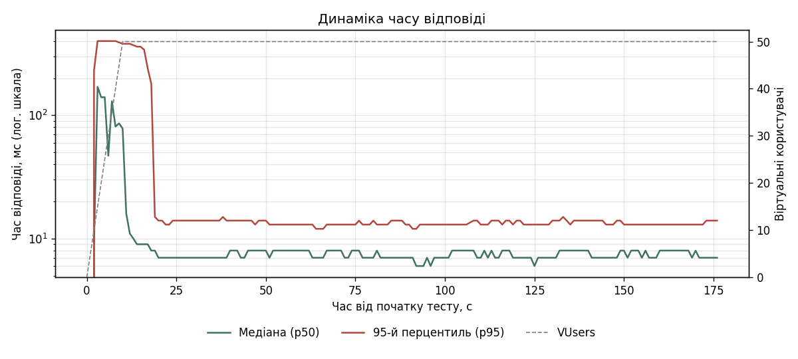
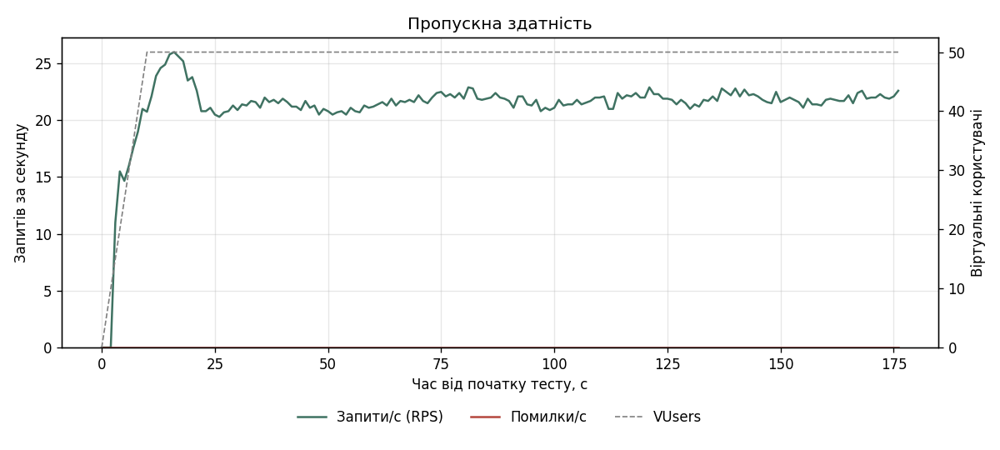
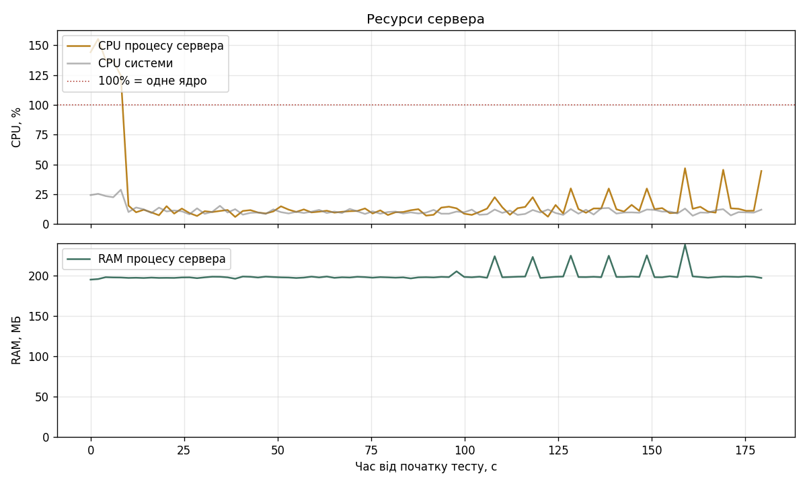
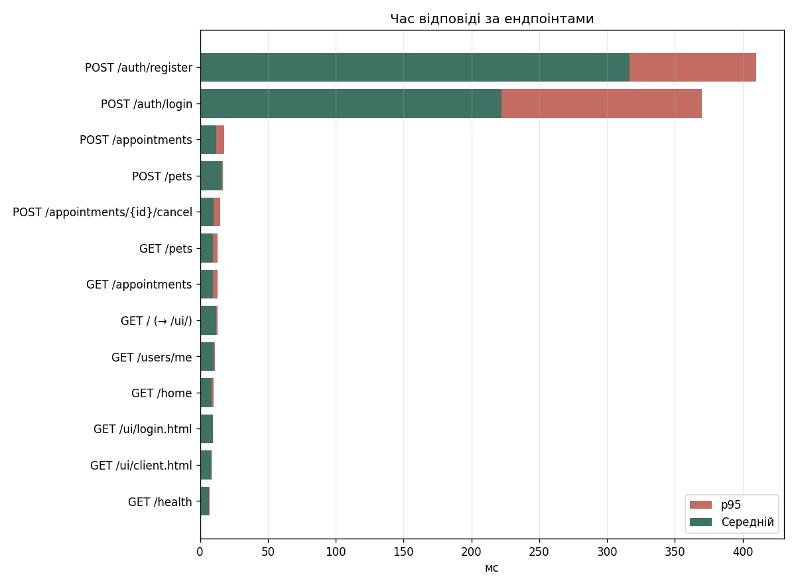

# Звіт навантажувального тестування — `before-50` (профіль `baseline`)

| Параметр | Значення |
|---|---|
| Інструмент | Locust |
| Профіль навантаження | 50 VUsers, розгін 5 корист./с (Ramp-Up ≈ 10 с), тривалість 180 с |
| Середовище | `sandbox`, http://localhost:80 |
| Суміш користувачів | клієнти 6 : анонімні 2 |
| Машина | Darwin arm64, 10 логічних ядер, Python 3.9.6 |
| Початок | 2026-11-22T12:52:31, фактична тривалість 181.4 с |

## Підсумкові метрики

| Ендпоінт | Запитів | Помилок | Error Rate | RPS | Avg, мс | Min, мс | Max, мс | p50, мс | p95, мс | p99, мс |
|---|---:|---:|---:|---:|---:|---:|---:|---:|---:|---:|
| POST /auth/register | 37 | 0 | 0.00% | 0.2 | 317 | 186 | 587 | 360 | 410 | 590 |
| POST /auth/login | 37 | 0 | 0.00% | 0.2 | 222 | 170 | 535 | 190 | 370 | 530 |
| POST /appointments | 185 | 0 | 0.00% | 1.0 | 12 | 3 | 25 | 13 | 18 | 23 |
| POST /pets | 231 | 0 | 0.00% | 1.3 | 16 | 3 | 343 | 11 | 17 | 180 |
| POST /appointments/{id}/cancel | 98 | 0 | 0.00% | 0.5 | 10 | 3 | 17 | 11 | 15 | 17 |
| GET / (→ /ui/) | 311 | 0 | 0.00% | 1.7 | 12 | 3 | 237 | 9 | 13 | 220 |
| GET /appointments | 569 | 0 | 0.00% | 3.2 | 10 | 2 | 196 | 9 | 13 | 43 |
| GET /pets | 744 | 0 | 0.00% | 4.2 | 10 | 3 | 355 | 9 | 13 | 35 |
| GET /users/me | 373 | 0 | 0.00% | 2.1 | 10 | 2 | 397 | 7 | 11 | 130 |
| GET /home | 791 | 0 | 0.00% | 4.4 | 9 | 2 | 236 | 7 | 10 | 160 |
| GET /ui/login.html | 220 | 0 | 0.00% | 1.2 | 10 | 2 | 227 | 5 | 9 | 220 |
| GET /ui/client.html | 197 | 0 | 0.00% | 1.1 | 9 | 2 | 351 | 5 | 8 | 280 |
| GET /health | 114 | 0 | 0.00% | 0.6 | 6 | 2 | 258 | 4 | 7 | 11 |
| **Усього (Aggregated)** | 3907 | 0 | 0.00% | 21.8 | 15 | 2 | 587 | 7 | 15 | 230 |

## Ресурси сервера

| Показник | Середнє | Максимум |
|---|---:|---:|
| CPU процесу сервера, % одного ядра | 20 | 155 |
| RAM процесу сервера, МБ | 200 | 238 |
| CPU PostgreSQL, % одного ядра | 2 | 8 |
| RAM PostgreSQL, МБ | 106 | 109 |
| CPU Redis, % одного ядра | 0 | 0 |
| RAM Redis, МБ | 0 | 0 |
| CPU системи, % | 11 | 29 |
| RAM системи, % | — | 66 |

> Locust працює на тій самій машині, що й сервер, тож частину CPU системи займає сам генератор навантаження. Для Docker «процес сервера» — це сума всіх реплік застосунку.

## Графіки

### Динаміка часу відповіді

### Пропускна здатність

### Ресурси сервера (CPU, RAM)

### Час відповіді за ендпоінтами

## Виявлені вузькі місця

1. **Автентифікація — найдорожча операція.** p95 входу/реєстрації 410 мс проти 13 мс (медіана p95 інших ендпоінтів). Ймовірна причина: хешування паролів bcrypt навмисно повільне і виконується синхронно всередині async-обробника, тож блокує цикл подій — поки рахується хеш, сервер не обробляє жодного іншого запиту. Можливе рішення: виконувати bcrypt у пулі потоків (`run_in_threadpool`) і/або запускати кілька воркерів uvicorn.
2. **Сплеск затримки.** p95 зріс до 400 мс (типове значення 13 мс) при 15 VUsers, під час розгону або одразу після нього, коли нові користувачі масово реєструються та входять.
3. **CPU.** Процес сервера досягав 155% одного ядра. Uvicorn з одним воркером використовує лише одне ядро, тож це стеля продуктивності незалежно від кількості ядер машини.
4. **RAM.** Пам'ять процесу 200–238 МБ — витоків пам'яті не помітно, якщо графік RAM не зростає безперервно.

> Розділ сформовано автоматично за порогами: Error Rate > 1%, p95 > 2× від базового ступеня, сплеск p95 > 3× від типового, CPU ≥ 90% одного ядра. Перевірте висновки за графіками.
