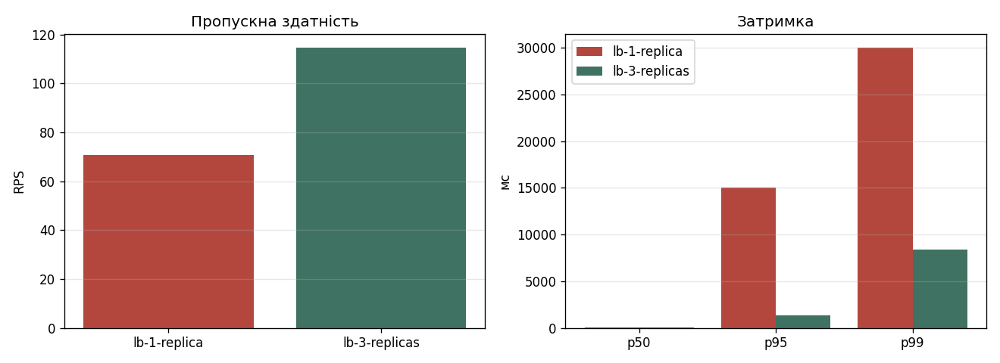
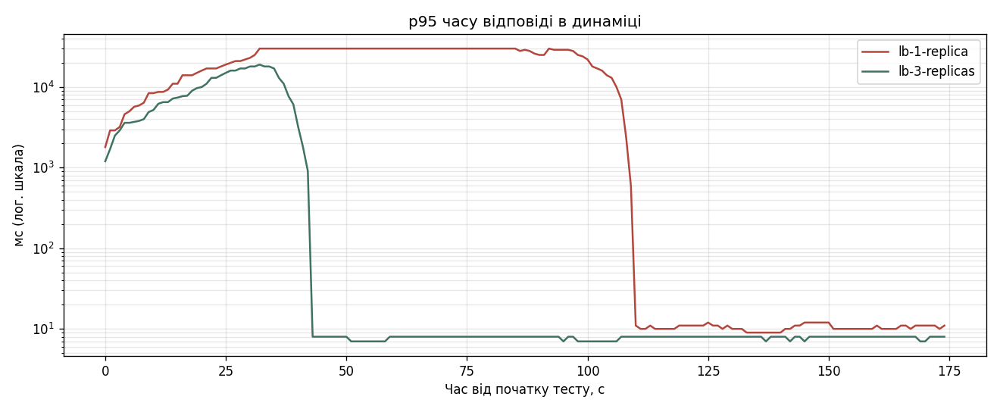

# Порівняння прогонів навантажувального тесту

Базовий прогін: `lb-1-replica`. Остання колонка — зміна останнього прогону відносно базового.

| Метрика | `lb-1-replica` | `lb-3-replicas` | Зміна відносно базового |
|---|---:|---:|---:|
| RPS | 70.7 | 114.5 | +62% ✅ |
| Latency avg, мс | 1840 | 300 | -84% ✅ |
| Latency p50, мс | 5 | 4 | -20% ✅ |
| Latency p95, мс | 15000 | 1300 | -91% ✅ |
| Latency p99, мс | 30000 | 8400 | -72% ✅ |
| Latency max, мс | 30020 | 25711 | -14% ✅ |
| Пік p95 у динаміці, мс | 30000 | 19000 | -37% ✅ |
| Error Rate, % | 2.14 | 0.01 | -100% ✅ |
| Запитів усього | 12685 | 20539 | |

## p95 ключових ендпоінтів, мс

| Ендпоінт | `lb-1-replica` | `lb-3-replicas` |
|---|---:|---:|
| POST /auth/register | 30000 | 20000 |
| POST /auth/login | 30000 | 20000 |
| GET /pets | 5800 | 9 |
| POST /appointments | 1200 | 12 |

## Графіки

Детальні звіти кожного прогону: [`lb-1-replica`](lb-1-replica/report.md), [`lb-3-replicas`](lb-3-replicas/report.md)
