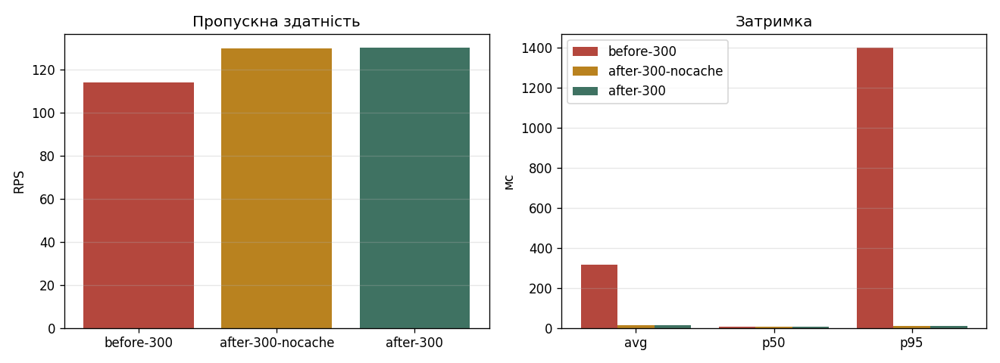
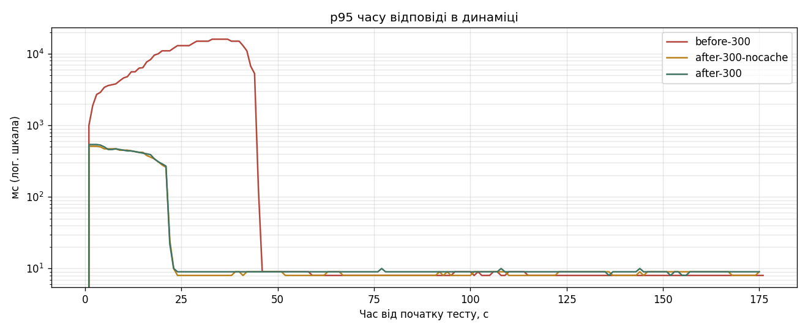
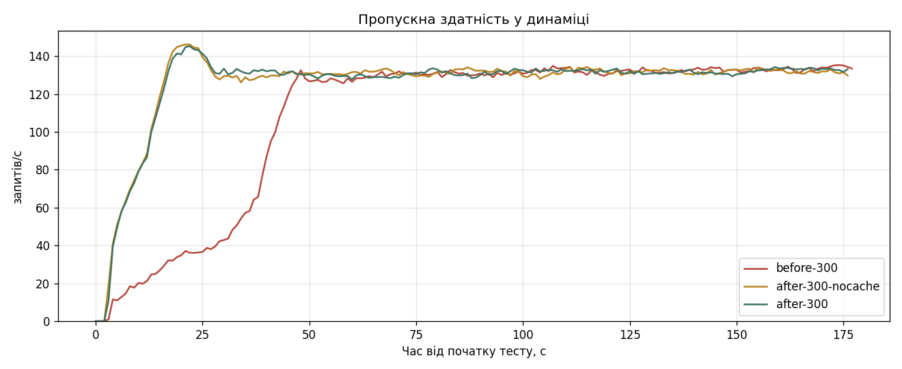
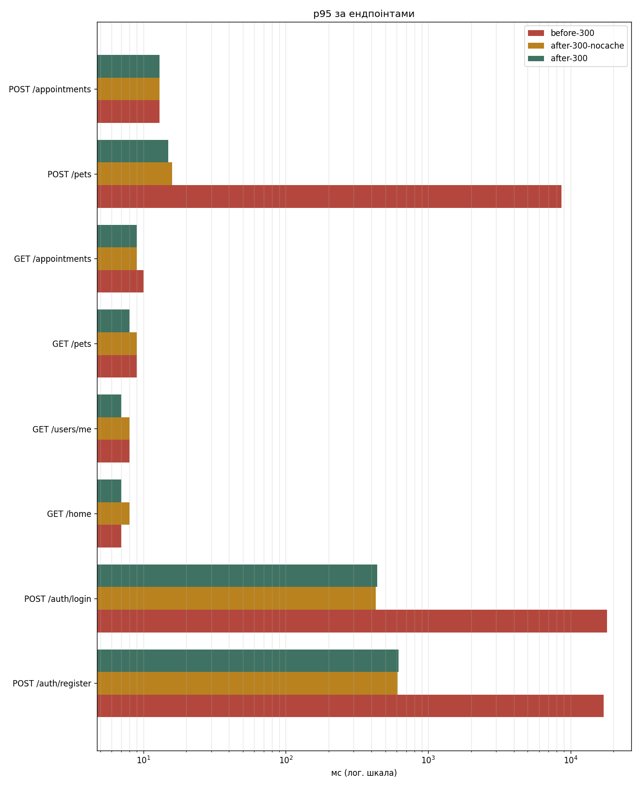

# ЛР №7: ДО і ПІСЛЯ оптимізації (300 VUsers)

Базовий прогін: `before-300`. Остання колонка — зміна `after-300` відносно базового.

| Метрика | `before-300` | `after-300-nocache` | `after-300` | Зміна |
|---|---:|---:|---:|---:|
| RPS | 114.1 | 130.1 | 130.2 | +14% ✅ |
| Latency avg, мс | 318 | 12 | 12 | -96% ✅ |
| Latency p50, мс | 4 | 4 | 4 | 0% |
| Latency p95, мс | 1400 | 11 | 11 | -99% ✅ |
| Latency p99, мс | 9600 | 310 | 290 | -97% ✅ |
| Latency max, мс | 30002 | 751 | 716 | -98% ✅ |
| Пік p95 у динаміці, мс | 16000 | 510 | 540 | -97% ✅ |
| Error Rate, % | 0.02 | 0.00 | 0.00 | -100% ✅ |
| CPU реплік сер., % ядра | 75 | 94 | 84 | +11% |
| CPU реплік макс., % ядра | 351 | 761 | 742 | +111% |
| RAM реплік макс., МБ | 236 | 203 | 217 | -8% ✅ |
| CPU PostgreSQL сер., % ядра | 4 | 5 | 3 | -31% ✅ |
| RAM Redis макс., МБ | 0.0 | 10.6 | 11.3 | — |
| Запитів усього | 20480 | 23298 | 23312 | |

## Ендпоінти: середній час / p95, мс

| Ендпоінт | `before-300` | `after-300-nocache` | `after-300` |
|---|---:|---:|---:|
| POST /auth/register | 5660 / 17000 | 393 / 610 | 388 / 620 |
| POST /auth/login | 6403 / 18000 | 302 / 430 | 302 / 440 |
| GET /home | 127 / 7 | 4 / 8 | 4 / 7 |
| GET /users/me | 153 / 8 | 4 / 8 | 4 / 7 |
| GET /pets | 101 / 9 | 5 / 9 | 4 / 8 |
| GET /appointments | 182 / 10 | 5 / 9 | 5 / 9 |
| POST /pets | 945 / 8600 | 7 / 16 | 8 / 15 |
| POST /appointments | 151 / 13 | 8 / 13 | 8 / 13 |

## Графіки

Детальні звіти кожного прогону: [`before-300`](before-300/report.md), [`after-300-nocache`](after-300-nocache/report.md), [`after-300`](after-300/report.md)
