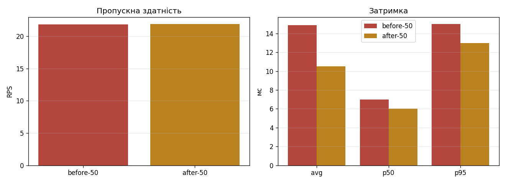
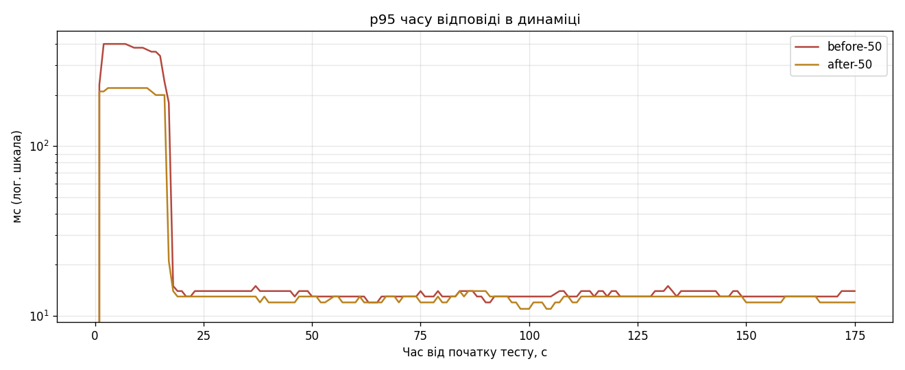
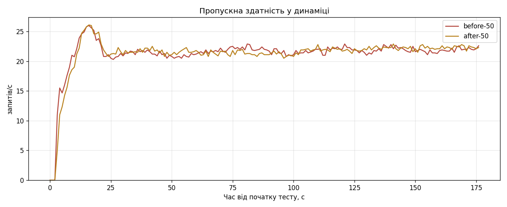
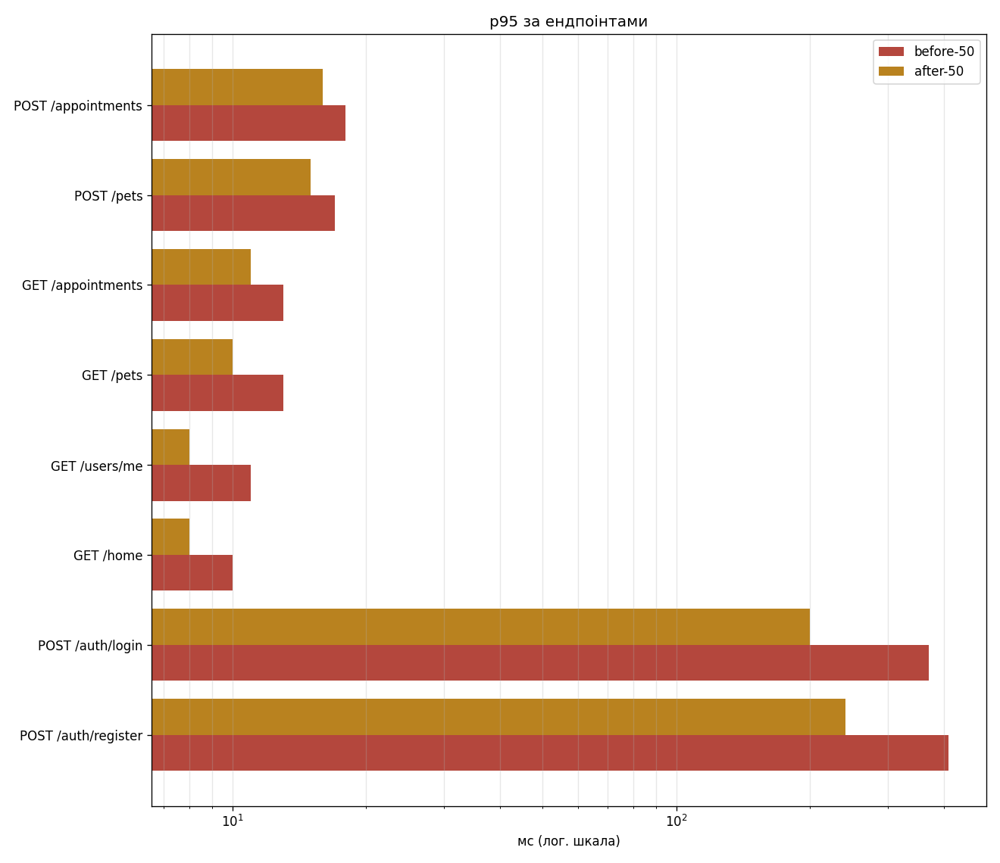

# ЛР №7: ДО і ПІСЛЯ оптимізації (профіль ЛР №4, 50 VUsers)

Базовий прогін: `before-50`. Остання колонка — зміна `after-50` відносно базового.

| Метрика | `before-50` | `after-50` | Зміна |
|---|---:|---:|---:|
| RPS | 21.8 | 21.9 | +0% |
| Latency avg, мс | 15 | 11 | -29% ✅ |
| Latency p50, мс | 7 | 6 | -14% ✅ |
| Latency p95, мс | 15 | 13 | -13% ✅ |
| Latency p99, мс | 230 | 200 | -13% ✅ |
| Latency max, мс | 587 | 238 | -59% ✅ |
| Пік p95 у динаміці, мс | 400 | 220 | -45% ✅ |
| Error Rate, % | 0.00 | 0.00 | — |
| CPU реплік сер., % ядра | 20 | 20 | +0% |
| CPU реплік макс., % ядра | 155 | 166 | +7% |
| RAM реплік макс., МБ | 238 | 242 | +2% |
| CPU PostgreSQL сер., % ядра | 2 | 1 | -39% ✅ |
| RAM Redis макс., МБ | 0.0 | 11.2 | — |
| Запитів усього | 3907 | 3917 | |

## Ендпоінти: середній час / p95, мс

| Ендпоінт | `before-50` | `after-50` |
|---|---:|---:|
| POST /auth/register | 317 / 410 | 216 / 240 |
| POST /auth/login | 222 / 370 | 192 / 200 |
| GET /home | 9 / 10 | 5 / 8 |
| GET /users/me | 10 / 11 | 5 / 8 |
| GET /pets | 10 / 13 | 6 / 10 |
| GET /appointments | 10 / 13 | 8 / 11 |
| POST /pets | 16 / 17 | 10 / 15 |
| POST /appointments | 12 / 18 | 11 / 16 |

## Графіки

Детальні звіти кожного прогону: [`before-50`](before-50/report.md), [`after-50`](after-50/report.md)
