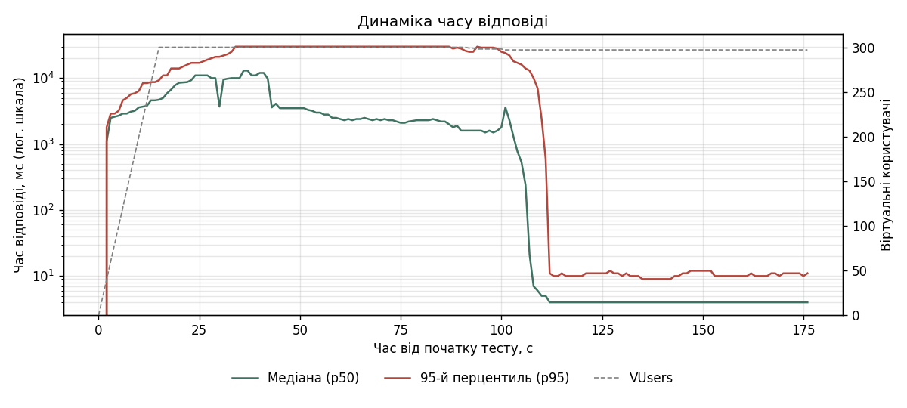
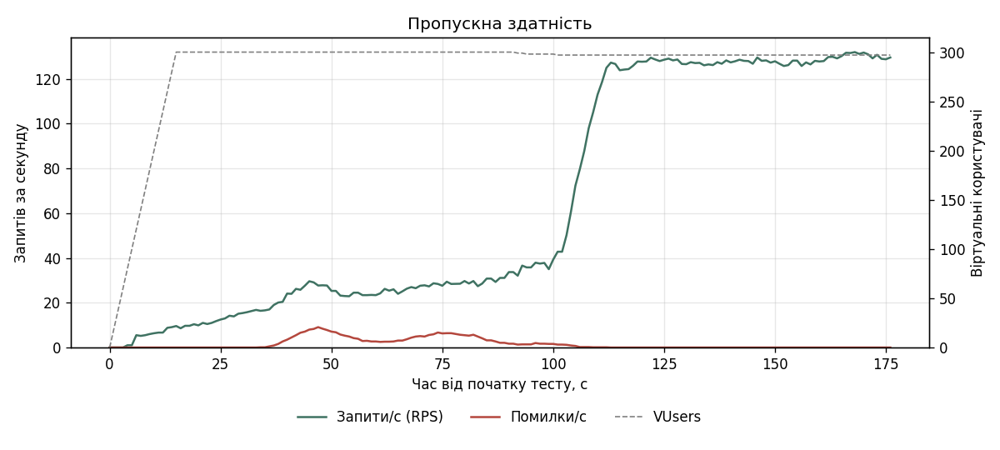
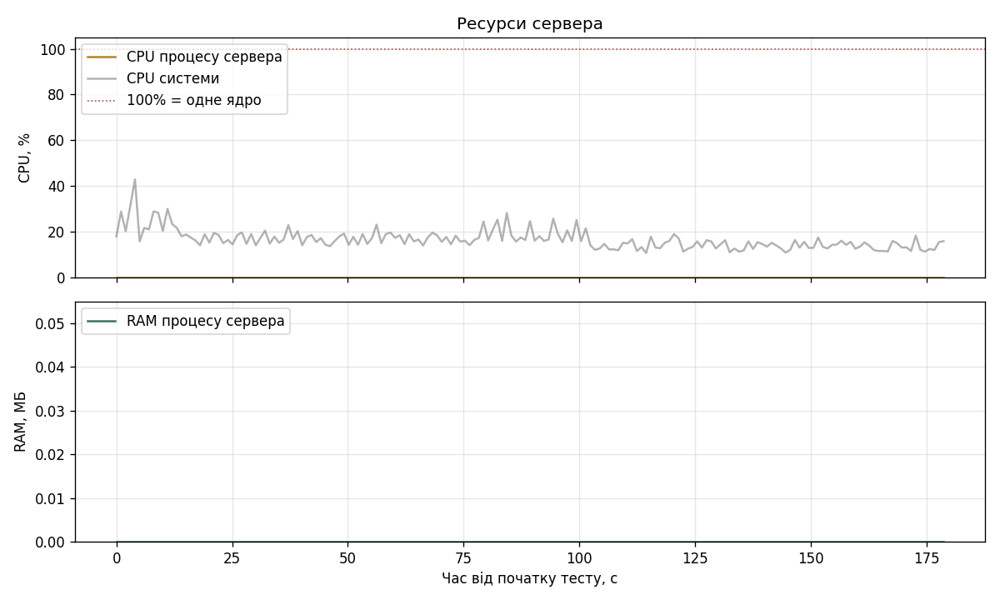
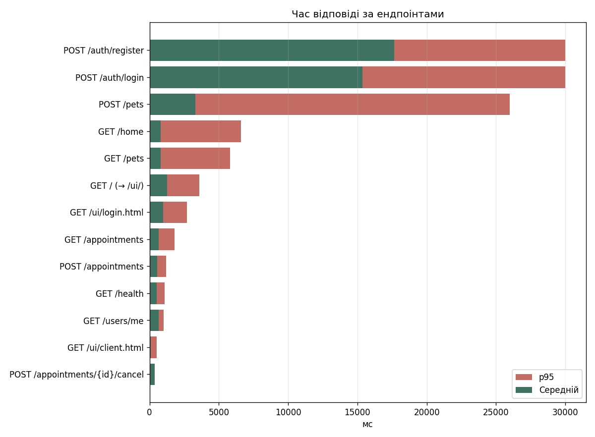

# Звіт навантажувального тестування — `lb-1-replica` (профіль `baseline`)

| Параметр | Значення |
|---|---|
| Інструмент | Locust |
| Профіль навантаження | 300 VUsers, розгін 20 корист./с (Ramp-Up ≈ 15 с), тривалість 180 с |
| Середовище | `sandbox`, http://localhost |
| Суміш користувачів | клієнти 6 : анонімні 2 |
| Машина | Darwin arm64, 10 логічних ядер, Python 3.9.6 |
| Початок | 2026-11-08T14:26:58, фактична тривалість 180.4 с |

## Підсумкові метрики

| Ендпоінт | Запитів | Помилок | Error Rate | RPS | Avg, мс | Min, мс | Max, мс | p50, мс | p95, мс | p99, мс |
|---|---:|---:|---:|---:|---:|---:|---:|---:|---:|---:|
| POST /auth/login | 299 | 77 | 25.75% | 1.7 | 15356 | 194 | 30011 | 14000 | 30000 | 30000 |
| POST /auth/register | 423 | 124 | 29.31% | 2.4 | 17641 | 664 | 30020 | 17000 | 30000 | 30000 |
| POST /pets | 784 | 35 | 4.46% | 4.4 | 3320 | 3 | 30010 | 8 | 26000 | 30000 |
| GET /home | 2152 | 9 | 0.42% | 12.0 | 817 | 1 | 30007 | 4 | 6600 | 21000 |
| GET /pets | 2141 | 11 | 0.51% | 11.9 | 815 | 2 | 30008 | 5 | 5800 | 25000 |
| GET / (→ /ui/) | 1410 | 0 | 0.00% | 7.9 | 1261 | 2 | 21465 | 9 | 3600 | 17000 |
| GET /ui/login.html | 984 | 0 | 0.00% | 5.5 | 985 | 1 | 20202 | 7 | 2700 | 14000 |
| GET /appointments | 1646 | 5 | 0.30% | 9.2 | 649 | 2 | 30008 | 5 | 1800 | 18000 |
| POST /appointments | 514 | 1 | 0.19% | 2.9 | 536 | 3 | 30007 | 7 | 1200 | 20000 |
| GET /health | 501 | 0 | 0.00% | 2.8 | 498 | 1 | 16298 | 4 | 1100 | 13000 |
| GET /users/me | 1070 | 7 | 0.65% | 6.0 | 668 | 2 | 30008 | 4 | 1000 | 26000 |
| GET /ui/client.html | 517 | 0 | 0.00% | 2.9 | 72 | 1 | 2818 | 4 | 510 | 1800 |
| POST /appointments/{id}/cancel | 244 | 2 | 0.82% | 1.4 | 354 | 3 | 30003 | 6 | 15 | 6800 |
| **Усього (Aggregated)** | 12685 | 271 | 2.14% | 70.7 | 1840 | 1 | 30020 | 5 | 15000 | 30000 |

## Ресурси сервера

| Показник | Середнє | Максимум |
|---|---:|---:|
| CPU процесу сервера, % одного ядра | 0 | 0 |
| RAM процесу сервера, МБ | 0 | 0 |
| CPU системи, % | 17 | 43 |
| RAM системи, % | — | 76 |

> Locust працює на тій самій машині, що й сервер, тож частину CPU системи займає сам генератор навантаження.

## Графіки

### Динаміка часу відповіді

### Пропускна здатність

### Ресурси сервера (CPU, RAM)

### Час відповіді за ендпоінтами

## Помилки

| Метод | Ендпоінт | Помилка | Кількість |
|---|---|---|---:|
| GET | GET /appointments | 504 Server Error: Gateway Time-out | 5 |
| POST | POST /pets | 504 Server Error: Gateway Time-out | 35 |
| POST | POST /auth/login | 504 Server Error: Gateway Time-out | 77 |
| POST | POST /auth/register | 504 Server Error: Gateway Time-out | 124 |
| POST | POST /appointments/{id}/cancel | 504 Server Error: Gateway Time-out | 2 |
| GET | GET /pets | 504 Server Error: Gateway Time-out | 11 |
| POST | POST /appointments | 504 Server Error: Gateway Time-out | 1 |
| GET | GET /users/me | 504 Server Error: Gateway Time-out | 7 |
| GET | GET /home | 504 Server Error: Gateway Time-out | 9 |

## Виявлені вузькі місця

1. **Помилки.** Загальний Error Rate 2.14% перевищує 1%. Ендпоінти з помилками: `POST /auth/login` (25.8%), `POST /auth/register` (29.3%), `POST /pets` (4.5%), `GET /home` (0.4%), `GET /pets` (0.5%), `GET /appointments` (0.3%), `POST /appointments` (0.2%), `GET /users/me` (0.7%), `POST /appointments/{id}/cancel` (0.8%).
2. **Автентифікація — найдорожча операція.** p95 входу/реєстрації 30000 мс проти 1800 мс (медіана p95 інших ендпоінтів). Ймовірна причина: хешування паролів bcrypt навмисно повільне і виконується синхронно всередині async-обробника, тож блокує цикл подій — поки рахується хеш, сервер не обробляє жодного іншого запиту. Можливе рішення: виконувати bcrypt у пулі потоків (`run_in_threadpool`) і/або запускати кілька воркерів uvicorn.
3. **CPU.** Максимальне завантаження процесу 0% одного ядра — запас по CPU є.
4. **RAM.** Пам'ять процесу 0–0 МБ — витоків пам'яті не помітно, якщо графік RAM не зростає безперервно.
5. **Типи помилок.** `POST /auth/register`: 504 Server Error: Gateway Time-out ×124; `POST /auth/login`: 504 Server Error: Gateway Time-out ×77; `POST /pets`: 504 Server Error: Gateway Time-out ×35.

> Розділ сформовано автоматично за порогами: Error Rate > 1%, p95 > 2× від базового ступеня, сплеск p95 > 3× від типового, CPU ≥ 90% одного ядра. Перевірте висновки за графіками.
