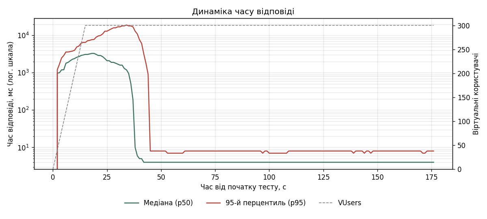
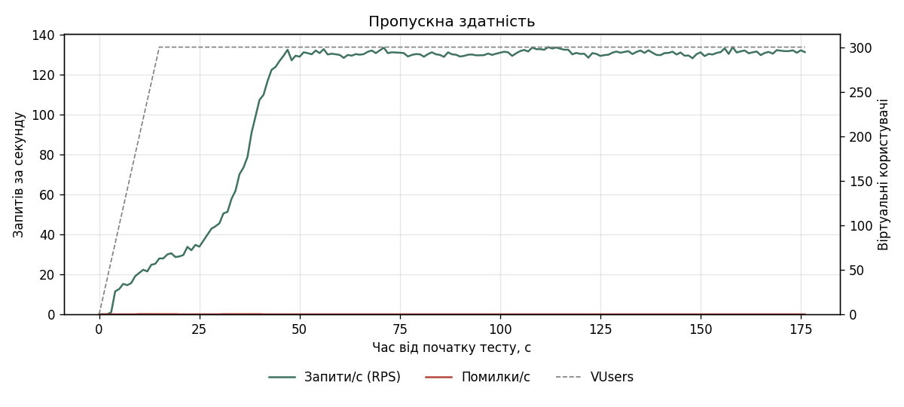
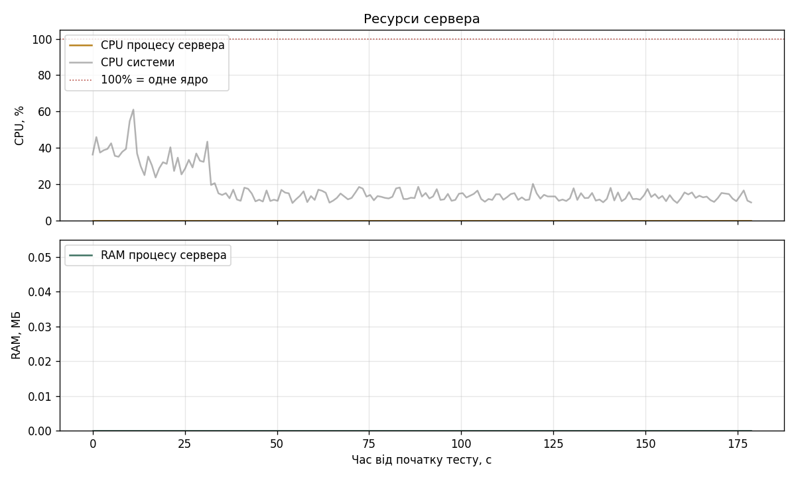
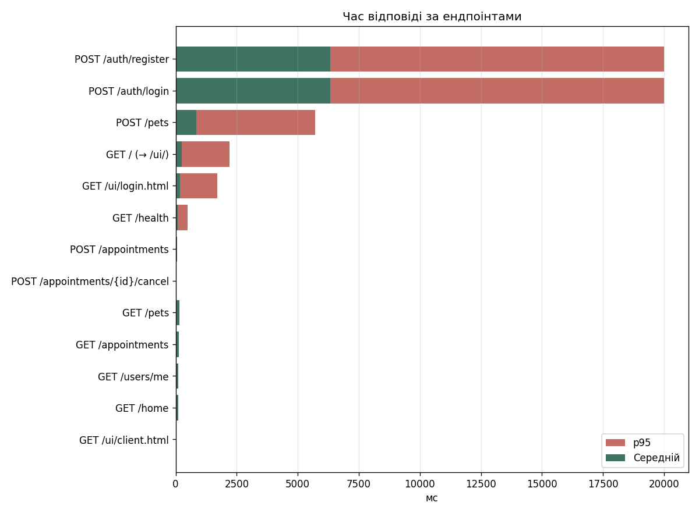

# Звіт навантажувального тестування — `lb-3-replicas` (профіль `baseline`)

| Параметр | Значення |
|---|---|
| Інструмент | Locust |
| Профіль навантаження | 300 VUsers, розгін 20 корист./с (Ramp-Up ≈ 15 с), тривалість 180 с |
| Середовище | `sandbox`, http://localhost |
| Суміш користувачів | клієнти 6 : анонімні 2 |
| Машина | Darwin arm64, 10 логічних ядер, Python 3.9.6 |
| Початок | 2026-11-08T14:30:06, фактична тривалість 180.3 с |

## Підсумкові метрики

| Ендпоінт | Запитів | Помилок | Error Rate | RPS | Avg, мс | Min, мс | Max, мс | p50, мс | p95, мс | p99, мс |
|---|---:|---:|---:|---:|---:|---:|---:|---:|---:|---:|
| POST /auth/login | 226 | 1 | 0.44% | 1.3 | 6333 | 5 | 25711 | 4000 | 20000 | 24000 |
| POST /auth/register | 226 | 0 | 0.00% | 1.3 | 6335 | 195 | 24281 | 3800 | 20000 | 24000 |
| POST /pets | 1149 | 0 | 0.00% | 6.4 | 843 | 3 | 25335 | 6 | 5700 | 16000 |
| GET / (→ /ui/) | 1739 | 0 | 0.00% | 9.7 | 250 | 2 | 5555 | 5 | 2200 | 4200 |
| GET /ui/login.html | 1181 | 0 | 0.00% | 6.6 | 174 | 1 | 4650 | 3 | 1700 | 3000 |
| GET /health | 594 | 0 | 0.00% | 3.3 | 84 | 1 | 3755 | 2 | 480 | 2200 |
| POST /appointments | 1019 | 1 | 0.10% | 5.7 | 54 | 3 | 6173 | 7 | 12 | 2100 |
| GET /appointments | 2984 | 0 | 0.00% | 16.6 | 117 | 2 | 19685 | 4 | 9 | 4400 |
| GET /pets | 3965 | 0 | 0.00% | 22.1 | 141 | 2 | 22026 | 4 | 9 | 5900 |
| POST /appointments/{id}/cancel | 560 | 0 | 0.00% | 3.1 | 29 | 3 | 10915 | 6 | 9 | 14 |
| GET /home | 3964 | 0 | 0.00% | 22.1 | 115 | 2 | 18937 | 3 | 7 | 4000 |
| GET /users/me | 1911 | 0 | 0.00% | 10.7 | 94 | 2 | 22729 | 3 | 7 | 3100 |
| GET /ui/client.html | 1021 | 0 | 0.00% | 5.7 | 25 | 1 | 2489 | 3 | 6 | 790 |
| **Усього (Aggregated)** | 20539 | 2 | 0.01% | 114.5 | 300 | 1 | 25711 | 4 | 1300 | 8400 |

## Ресурси сервера

| Показник | Середнє | Максимум |
|---|---:|---:|
| CPU процесу сервера, % одного ядра | 0 | 0 |
| RAM процесу сервера, МБ | 0 | 0 |
| CPU системи, % | 18 | 61 |
| RAM системи, % | — | 76 |

> Locust працює на тій самій машині, що й сервер, тож частину CPU системи займає сам генератор навантаження.

## Графіки

### Динаміка часу відповіді

### Пропускна здатність

### Ресурси сервера (CPU, RAM)

### Час відповіді за ендпоінтами

## Помилки

| Метод | Ендпоінт | Помилка | Кількість |
|---|---|---|---:|
| POST | POST /auth/login | 502 Server Error: Bad Gateway | 1 |
| POST | POST /appointments | 502 Server Error: Bad Gateway | 1 |

## Виявлені вузькі місця

1. **Поодинокі помилки.** Невдалих запитів: 2 (0.01%) — див. таблицю помилок.
2. **Автентифікація — найдорожча операція.** p95 входу/реєстрації 20000 мс проти 9 мс (медіана p95 інших ендпоінтів). Ймовірна причина: хешування паролів bcrypt навмисно повільне і виконується синхронно всередині async-обробника, тож блокує цикл подій — поки рахується хеш, сервер не обробляє жодного іншого запиту. Можливе рішення: виконувати bcrypt у пулі потоків (`run_in_threadpool`) і/або запускати кілька воркерів uvicorn.
3. **Сплеск затримки.** p95 зріс до 19000 мс (типове значення 8 мс) при 300 VUsers, під час розгону або одразу після нього, коли нові користувачі масово реєструються та входять.
4. **CPU.** Максимальне завантаження процесу 0% одного ядра — запас по CPU є.
5. **RAM.** Пам'ять процесу 0–0 МБ — витоків пам'яті не помітно, якщо графік RAM не зростає безперервно.
6. **Типи помилок.** `POST /auth/login`: 502 Server Error: Bad Gateway ×1; `POST /appointments`: 502 Server Error: Bad Gateway ×1.

> Розділ сформовано автоматично за порогами: Error Rate > 1%, p95 > 2× від базового ступеня, сплеск p95 > 3× від типового, CPU ≥ 90% одного ядра. Перевірте висновки за графіками.
