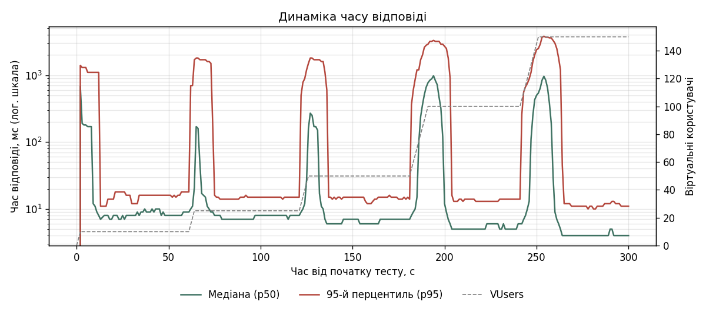
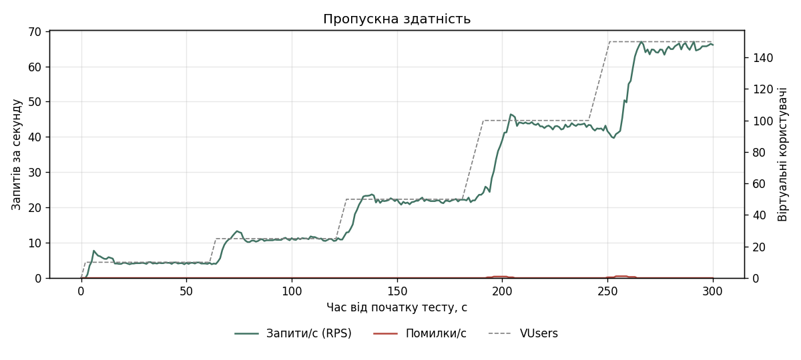
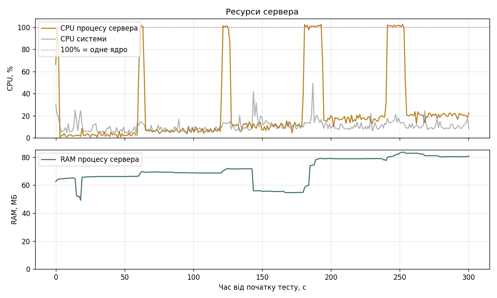
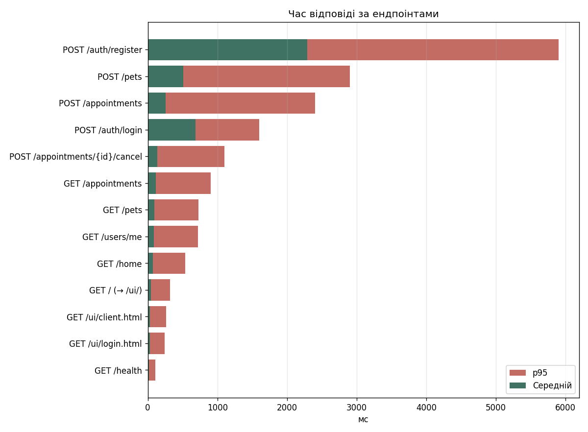

# Звіт навантажувального тестування — профіль `step`

| Параметр | Значення |
|---|---|
| Інструмент | Locust |
| Профіль навантаження | ступені 10 → 25 → 50 → 100 → 150 VUsers по 60 с, розгін 5 корист./с |
| Середовище | `sandbox`, http://127.0.0.1:8000 |
| Суміш користувачів | клієнти 6 : анонімні 2 |
| Машина | Darwin arm64, 10 логічних ядер, Python 3.9.6 |
| Початок | 2026-10-25T16:40:58, фактична тривалість 301.3 с |

## Підсумкові метрики

| Ендпоінт | Запитів | Помилок | Error Rate | RPS | Avg, мс | Min, мс | Max, мс | p50, мс | p95, мс | p99, мс |
|---|---:|---:|---:|---:|---:|---:|---:|---:|---:|---:|
| POST /auth/register | 118 | 6 | 5.08% | 0.4 | 2288 | 2 | 6990 | 2000 | 5900 | 6400 |
| POST /pets | 509 | 2 | 0.39% | 1.7 | 509 | 3 | 6226 | 12 | 2900 | 4900 |
| POST /appointments | 373 | 0 | 0.00% | 1.2 | 253 | 4 | 5158 | 12 | 2400 | 3700 |
| POST /auth/login | 112 | 0 | 0.00% | 0.4 | 687 | 169 | 3673 | 520 | 1600 | 2500 |
| POST /appointments/{id}/cancel | 209 | 0 | 0.00% | 0.7 | 139 | 3 | 2751 | 10 | 1100 | 2300 |
| GET /appointments | 1174 | 0 | 0.00% | 3.9 | 113 | 2 | 3209 | 7 | 900 | 1900 |
| GET /pets | 1564 | 0 | 0.00% | 5.2 | 94 | 2 | 2451 | 7 | 730 | 1800 |
| GET /users/me | 845 | 1 | 0.12% | 2.8 | 89 | 1 | 4097 | 4 | 720 | 1600 |
| GET /home | 1636 | 0 | 0.00% | 5.4 | 72 | 1 | 3802 | 5 | 540 | 1500 |
| GET / (→ /ui/) | 761 | 0 | 0.00% | 2.5 | 43 | 1 | 719 | 5 | 320 | 570 |
| GET /ui/client.html | 382 | 0 | 0.00% | 1.3 | 33 | 1 | 628 | 3 | 260 | 510 |
| GET /ui/login.html | 465 | 0 | 0.00% | 1.5 | 33 | 1 | 513 | 3 | 240 | 370 |
| GET /health | 207 | 0 | 0.00% | 0.7 | 18 | 0 | 300 | 2 | 110 | 240 |
| **Усього (Aggregated)** | 8355 | 9 | 0.11% | 27.8 | 152 | 0 | 6990 | 6 | 1100 | 2800 |

## Ресурси сервера

| Показник | Середнє | Максимум |
|---|---:|---:|
| CPU процесу сервера, % одного ядра | 23 | 103 |
| RAM процесу сервера, МБ | 71 | 84 |
| CPU системи, % | 11 | 49 |
| RAM системи, % | — | 79 |

> Locust працює на тій самій машині, що й сервер, тож частину CPU системи займає сам генератор навантаження.

## Результати за ступенями навантаження

| VUsers | RPS | p50, мс | p95, мс | max p95, мс | Error Rate | CPU сервера сер./макс., % | RAM, МБ |
|---:|---:|---:|---:|---:|---:|---:|---:|
| 10 | 4.2 | 8 | 16 | 1300 | 0.00% | 4 / 78 | 66 |
| 25 | 10.9 | 8 | 15 | 1800 | 0.00% | 7 / 57 | 70 |
| 50 | 21.9 | 7 | 15 | 1800 | 0.00% | 14 / 98 | 72 |
| 100 | 43.1 | 5 | 14 | 3300 | 0.00% | 23 / 102 | 79 |
| 150 | 64.8 | 4 | 12 | 3800 | 0.00% | 26 / 103 | 84 |

## Графіки

### Динаміка часу відповіді

### Пропускна здатність

### Ресурси сервера (CPU, RAM)

### Час відповіді за ендпоінтами

## Помилки

| Метод | Ендпоінт | Помилка | Кількість |
|---|---|---|---:|
| POST | POST /auth/register | 500 Server Error: Internal Server Error | 3 |
| POST | POST /pets | 500 Server Error: Internal Server Error | 2 |
| POST | POST /auth/register | ConnectionResetError | 3 |
| GET | GET /users/me | ConnectionResetError | 1 |

## Виявлені вузькі місця

1. **Поодинокі помилки.** Невдалих запитів: 9 (0.11%) — див. таблицю помилок.
2. **Автентифікація — найдорожча операція.** p95 входу/реєстрації 5900 мс проти 720 мс (медіана p95 інших ендпоінтів). Ймовірна причина: хешування паролів bcrypt навмисно повільне і виконується синхронно всередині async-обробника, тож блокує цикл подій — поки рахується хеш, сервер не обробляє жодного іншого запиту. Можливе рішення: виконувати bcrypt у пулі потоків (`run_in_threadpool`) і/або запускати кілька воркерів uvicorn.
3. **Сплеск затримки.** p95 зріс до 3800 мс (типове значення 15 мс) при 150 VUsers, під час розгону або одразу після нього, коли нові користувачі масово реєструються та входять.
4. **CPU.** Процес сервера досягав 103% одного ядра. Uvicorn з одним воркером використовує лише одне ядро, тож це стеля продуктивності незалежно від кількості ядер машини.
5. **RAM.** Пам'ять процесу 71–84 МБ — витоків пам'яті не помітно, якщо графік RAM не зростає безперервно.
6. **Типи помилок.** `POST /auth/register`: 500 Server Error: Internal Server Error ×3; `POST /auth/register`: ConnectionResetError ×3; `POST /pets`: 500 Server Error: Internal Server Error ×2.
7. **Помилки 500.** Подробиці видно лише в лозі сервера (рядки «Необроблена помилка …»). Для SQLite під конкурентним записом типова причина — `database is locked`: SQLite дозволяє лише одного записувача, а поки цикл подій заблоковано (наприклад, хешуванням bcrypt), транзакція не завершується і інші запити перевищують тайм-аут очікування. Рішення — PostgreSQL для production.
8. **Обірвані з'єднання.** Частина запитів завершилась `Connection reset` — сервер не встигав приймати нові з'єднання, поки цикл подій був зайнятий.

> Розділ сформовано автоматично за порогами: Error Rate > 1%, p95 > 2× від базового ступеня, сплеск p95 > 3× від типового, CPU ≥ 90% одного ядра. Перевірте висновки за графіками.
